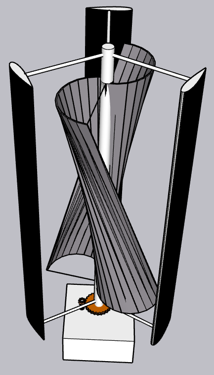

# Eco Spin Hybrid Wind Turbine

A hybrid vertical axis wind turbine that combines H-type Darrieus and helical Savonius rotors to explore small-scale renewable electricity generation for Abu Simbel.

**STEM capstone | Team 10116 | 2024-2025 Second semester**

## Egypt grand challenges

Improving the use of alternative energy and reducing pollution.

## Prototype

Lift and drag driven rotors transfer rotation through a central shaft and gear mechanism to a generator.

## Project materials

| Material | File |
| --- | --- |
| Portfolio | [Research portfolio](portfolio.pdf) |
| Poster | [Full-size poster](poster-fullsize.pdf) |
| Poster | [A4 poster](poster-a4.pdf) |
| Prototype design | [Design illustrations and model availability](DESIGN.md) |

## Research context

This repository presents a student team research project. The portfolio contains the project background, design reasoning, methods, and reported findings. Prototype results are reported in their original educational context.

## Design and reported results

- Combined a helical Savonius starter rotor with an H-Darrieus rotor using NACA 0018 aluminum blades.
- Analyzed lift, drag, aspect ratio, tip-speed ratio, a generator speed of approximately 1,455 RPM, and a 1:9 gear ratio.
- Prototype: 1.2 m tall, 7.0 kg, and 0.35 cubic meters.
- Averaged 0.1375 W during a five-minute test at approximately 4.4 m/s wind, exceeding the 0.133 W target, and charged a battery through a dynamo.
- Final grade: A.

The results and distinctions above are reported in the project portfolio and the application CV.

## Attribution

This project was developed collaboratively by the team credited in the portfolio. This repository is maintained by [Yaseen301](https://github.com/Yaseen301). Team authorship and source references remain in the original documents.

